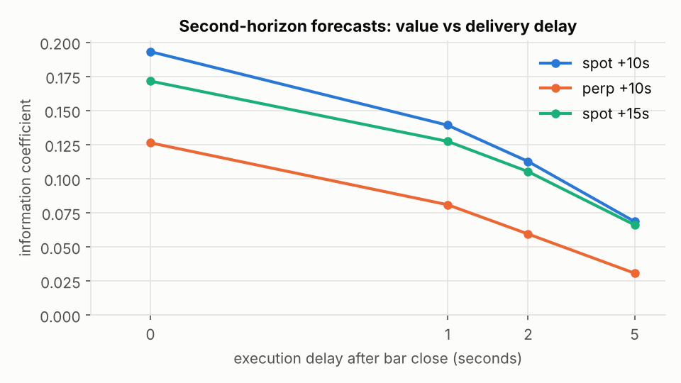
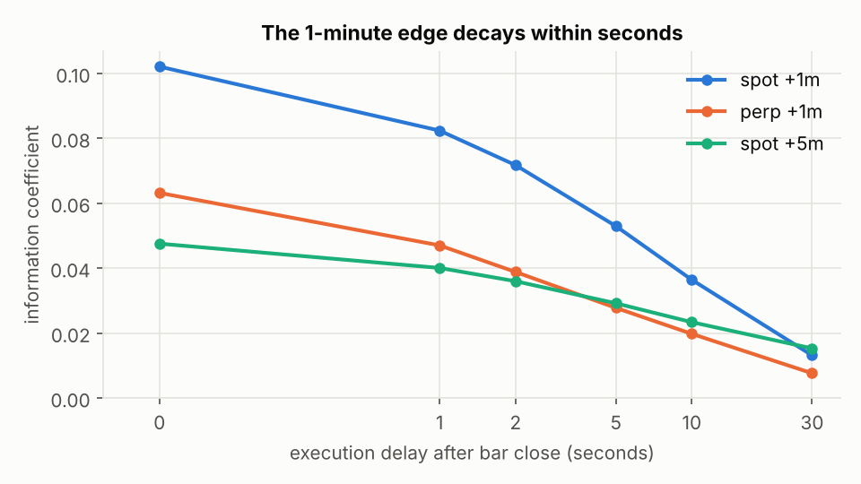
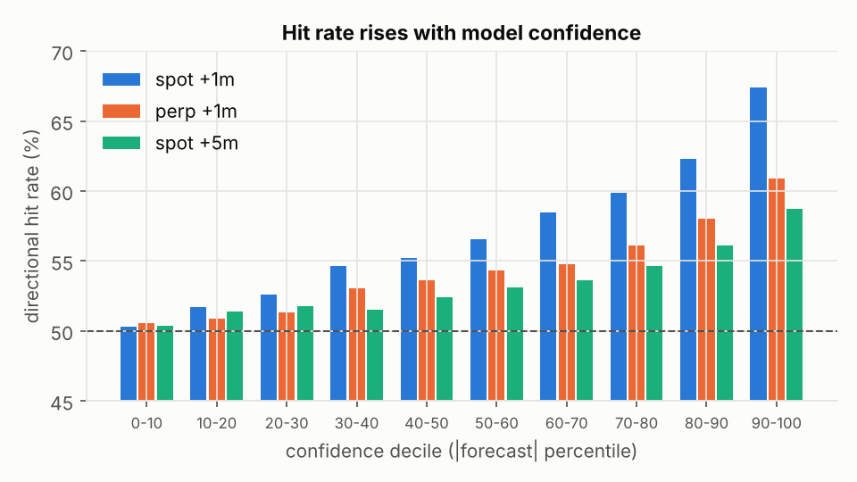

# btc-predict — 1-to-5-minute Bitcoin forecaster

Every minute, this forecasts how BTC will move over the **next 10 seconds, 15 seconds, and 1, 2,
3, 4 and 5 minutes**. It covers both Binance spot (BTC/USDT) and the USD-M perpetual. Each forecast includes:
* a calibrated **P(up)**
* an expected move
* 80% and 95% bands
* a confidence percentile, with the historical hit rate at that confidence level

The models were built from 18 months of one-second data (~790k minute bars) across 23 instruments
and 3 venues: Binance spot, Binance futures and Coinbase. The headline numbers come from a **frozen 6-month holdout (May → Oct 2026)** that
was not used for any design decision.

> **Read this first.** At 1–5 minute horizons Bitcoin is close to a random walk.
> * A real, durable edge here looks like a **53–55% hit rate on all minutes**. It rises to
>   **60–70% on the most confident 1–10%**.
> * The 1-minute edge is mostly **seconds-scale lead-lag**. It loses about a third of its value
>   if you act 2 seconds late, and about half at 5 seconds (see the latency chart).
> * It is smaller than taker fees (~1–10 bp per side). Treat this as a high-quality *signal* —
>   for market making, execution timing, or short-horizon prediction markets — not as a
>   standalone money printer.
>
> Be suspicious of anything above ~56% on *all* 1-minute bars. Our own spot +1m holdout figure
> (56.9%) tripped exactly that alarm. It was accepted only after a leak test and a model-free
> check traced it to a calm-market regime ([FINDINGS §3b](docs/FINDINGS.md)). In volatile months,
> expect ~54%.

## Results: 6-month frozen holdout (May → Oct 2026, ~260k forecasts per target)

Walk-forward evaluation, with the model retrained every two months on all prior data. No design
decision ever looked at these months.

The **full** model uses Binance spot + perpetual + ETH-perp + 17 alts + Coinbase. The **spot**
model uses no futures data at all and runs wherever Binance's public spot mirror and Coinbase are
reachable.

**Column guide**
* **hit rate**: share of non-flat minutes where the forecast sign was right.
* **top-k% conf.**: hit rate on the k% of minutes where the model was most confident.
* **log-loss skill**: P(up) improvement over a constant 50/50 forecast.
* **hit @ +2s / +5s**: the forecast starts from the price 2 or 5 seconds after the bar close, i.e.
  what a slower client actually gets. The live CLI delivers forecasts about **3.2 s** after the
  close: it waits 2.0 s until exchange data are final (see *Training/serving skew* below), then
  computes for about 1.2 s.

| model | target | hit rate | AUC | IC | top-10% conf. hit | top-1% conf. hit | log-loss skill | hit @ +2s | hit @ +5s | IC core → ens |
|---|---|---|---|---|---|---|---|---|---|---|
| full | spot +10s | **62.4%** | 0.670 | 0.193 | 77.4% | 81.7% | 6.55% | 58.4% | 55.6% | 0.179 → 0.193 |
| full | spot +15s | **61.3%** | 0.656 | 0.172 | 76.1% | 82.8% | 5.51% | 58.0% | 55.6% | 0.158 → 0.172 |
| full | spot +1m | **56.9%** | 0.597 | 0.102 | 67.4% | 73.9% | 2.14% | 55.3% | 54.1% | 0.094 → 0.102 |
| full | spot +2m | **55.0%** | 0.570 | 0.073 | 62.6% | 68.6% | 1.10% | 53.9% | 53.0% | 0.068 → 0.073 |
| full | spot +3m | **54.1%** | 0.557 | 0.060 | 60.6% | 66.3% | 0.74% | 53.2% | 52.6% | 0.056 → 0.060 |
| full | spot +4m | **53.6%** | 0.552 | 0.053 | 59.3% | 64.7% | 0.60% | 52.9% | 52.4% | 0.049 → 0.053 |
| full | spot +5m | **53.4%** | 0.547 | 0.048 | 58.8% | 64.4% | 0.50% | 52.7% | 52.3% | 0.043 → 0.048 |
| full | perp +10s | **58.1%** | 0.613 | 0.126 | 70.3% | 76.2% | 2.88% | 54.9% | 53.0% | 0.102 → 0.126 |
| full | perp +15s | **57.1%** | 0.600 | 0.110 | 68.4% | 73.9% | 2.26% | 54.5% | 52.9% | 0.089 → 0.110 |
| full | perp +1m | **54.4%** | 0.561 | 0.063 | 61.0% | 67.6% | 0.86% | 53.0% | 52.4% | 0.052 → 0.063 |
| full | perp +2m | **53.1%** | 0.544 | 0.042 | 58.0% | 61.2% | 0.43% | 52.2% | 51.8% | 0.034 → 0.042 |
| full | perp +3m | **52.7%** | 0.538 | 0.035 | 56.9% | 60.8% | 0.33% | 52.1% | 51.8% | 0.028 → 0.035 |
| full | perp +4m | **52.6%** | 0.536 | 0.031 | 56.6% | 60.1% | 0.30% | 52.0% | 51.8% | 0.025 → 0.031 |
| full | perp +5m | **52.3%** | 0.534 | 0.030 | 57.3% | 60.7% | 0.28% | 51.9% | 51.7% | 0.024 → 0.030 |
| spot | spot +10s | **61.3%** | 0.658 | 0.180 | 76.4% | 81.7% | 5.70% | 58.0% | 55.4% | 0.148 → 0.180 |
| spot | spot +15s | **60.4%** | 0.646 | 0.161 | 74.9% | 81.5% | 4.84% | 57.6% | 55.3% | 0.131 → 0.161 |
| spot | spot +1m | **56.5%** | 0.593 | 0.097 | 66.8% | 73.9% | 1.95% | 55.2% | 54.0% | 0.079 → 0.097 |
| spot | spot +2m | **54.9%** | 0.568 | 0.070 | 62.3% | 67.9% | 1.02% | 53.8% | 53.0% | 0.056 → 0.070 |
| spot | spot +3m | **54.0%** | 0.556 | 0.059 | 60.2% | 64.6% | 0.70% | 53.1% | 52.6% | 0.047 → 0.059 |
| spot | spot +4m | **53.6%** | 0.550 | 0.052 | 59.4% | 63.0% | 0.57% | 52.9% | 52.4% | 0.042 → 0.052 |
| spot | spot +5m | **53.3%** | 0.547 | 0.048 | 58.7% | 63.6% | 0.50% | 52.7% | 52.4% | 0.037 → 0.048 |

**Stability.** All **126 of 126** (target × month) holdout ICs are positive. The full-model
monthly IC ranges are:
* spot +1m: 0.079 – 0.126
* perp +1m: 0.045 – 0.077
* perp +5m: 0.022 – 0.034

**Regime caveat (important).** The holdout was a *calm* period. Every signal here is 2–3× stronger
in calm markets (see below and [`docs/FINDINGS.md`](docs/FINDINGS.md) §3b). On the three volatile,
never-tuned confirmation months (Dec 2025, Feb 2026, Apr 2026), the same architecture scored:

| target | IC | hit rate |
|---|---|---|
| perp +1m | 0.050 | 53.6% |
| spot +1m | 0.060 | 54.2% |
| perp +5m | 0.028 | 52.5% |
| spot +5m | 0.032 | 52.8% |

Treat these as the **conservative** numbers and the holdout as the calm-market numbers.

### The 10- and 15-second horizons

These horizons are the most predictable, and for a mechanical reason: this is exactly the window
in which Binance spot finishes catching up with the perpetual, Coinbase and the ETH perp.
* **At the bar close:** spot +10s hits 62.4% overall and 77% on its 10% most confident calls.
* **After delivery delay:** the edge belongs to whoever acts first. With the live CLI's ~3 s
  delivery, expect a hit rate of about 56–58% and an IC of about 0.09 for spot +10s; see the
  "+2s/+5s" columns.
* **In basis points:** the moves are small. The average |move| in a 10-second window is ~1.2 bp,
  and the gross edge is 0.78 bp in the top-confidence decile (0.45 bp at +2s).
* **What it's good for:** execution timing — when to send an order in the next few seconds — and
  short-horizon probability products. It is not a fee-paying taker strategy.
* **Faster delivery:** a websocket client co-located with the exchanges would keep far more of
  the edge than this REST-polling CLI.







### When is Bitcoin predictable? (holdout, full model)

| slice | spot +1m IC / hit | perp +1m IC / hit | perp +5m IC / hit |
|---|---|---|---|
| calm (low-vol tercile) | 0.198 / 60.3% | 0.119 / 55.9% | 0.045 / 52.3% |
| stormy (high-vol tercile) | 0.083 / 54.2% | 0.055 / 53.0% | 0.030 / 52.1% |
| weekend | 0.129 / 59.4% | 0.080 / 55.7% | 0.050 / 53.2% |
| weekday | 0.100 / 56.0% | 0.062 / 53.8% | 0.025 / 51.9% |
| US session 13–21 UTC | 0.086 / 56.0% | 0.056 / 53.9% | 0.028 / 52.4% |

This pattern was predicted from the DEV months *before* the holdout was opened. The mechanism:
fewer participants and slower cross-venue arbitrage make the seconds-scale lead-lag a larger and
more persistent part of each minute's move.

### Regime-aware uncertainty

The 80% bands are conditional on the current volatility regime (volatility relative to its own
1-day median). That matters because volatility mean-reverts: calm stretches tend to be followed
by larger moves, and storms by smaller ones.

| 80% band coverage (spot +5m, causal evaluation) | calm | normal | stormy | right after a vol shock | width |
|---|---|---|---|---|---|
| static bands | 75.9% | 80.1% | 83.9% | 85.7% | 24.4 bp |
| **regime-conditional (shipped)** | **78.5%** | **79.3%** | **80.6%** | **79.6%** | **23.4 bp** |

Bands are also scaled by **New York hour**, which is DST-aware. BTC's moves are 10–18% larger
in the hour of the US equity open (9:30 ET) and slightly larger around the 8:30 ET macro
releases. Fitted on May–Jul and tested on Aug–Oct, this lifted coverage in the open hour from
75–78% to 78–81%, with overall coverage unchanged at ~80%.

Bands are also conditioned on the **microstructure regime**: the ratio of 1-minute variance to
summed 1-second variance. When second-scale order flow is persistent (trending), multi-second
moves exceed what 1-second volatility implies. Tested out of sample, this raised coverage in the
trending tercile from 77–80% to 79–82%.

The live forward test (below) ran on an unusually trending afternoon. Even so, its bands
under-covered (60–72%), so treat the 80% bands as approximate when the market is moving in one
direction.

The P(up) map was also tested for regime dependence:
* adaptive windows of 3, 7 and 14 days;
* volatility-interaction terms;
* a confidence × regime table.

None beat the static logistic map, because the model's own forecast strength already shrinks in
volatile markets. The live output shows the current regime and the historical hit rate for calls
of that confidence in that regime.

### What the edge is worth

Gross edge per trade (bp) if you trade the forecast direction and exit after h minutes:

| target | all minutes | top 10% | top 1% | avg move in top 1% |
|---|---|---|---|---|
| spot +1m | 0.49 bp (0.32 @+2s) | 0.90 (0.67) | 1.02 (0.77) | 1.7 bp |
| perp +1m | 0.30 (0.17) | 0.61 (0.39) | 0.90 (0.64) | 2.2 bp |
| spot +5m | 0.49 (0.35) | 1.02 (0.83) | 1.15 (1.01) | 3.2 bp |
| perp +5m | 0.28 (0.19) | 0.79 (0.64) | 1.49 (1.33) | 6.7 bp |

The model is most confident in *quiet* minutes, which have the smallest moves. Edges are about
1 bp against 4–10 bp of round-trip taker fees, so this is **not a standalone taker strategy**.
It is useful as:
* a quote-skewing or inventory signal for market makers;
* an execution-timing signal;
* calibrated probabilities for short-horizon up/down markets;
* an input to slower strategies.

LIVE_SECTION


## Built for regime change

Crypto microstructure changes constantly: venues gain and lose market share, volatility
regimes flip, and arbitrage capital comes and goes. Each defense below was tested, not assumed:

1. **Scale-free inputs.** Every return is measured in units of current volatility and every flow
   in units of typical volume, so a calm month and a wild month look alike to the model.
2. **The model sees the regime.** Volatility-state features let it learn that the same signal is
   weaker in storms. Its forecasts shrink on their own, which is why a static P(up) map stays
   calibrated within regimes.
3. **Core + satellite + online learning.** When BTC/FDUSD lost 97% of its volume in Feb 2026, a
   satellite-only model fell to IC 0.015. The online layer (h=1) moved weight back to the robust
   core within days (IC 0.033). It keeps learning from every realized outcome live.
4. **Regime-conditional uncertainty.** Bands keep ~80% coverage in calm, normal and stormy
   markets, and right after volatility shocks.
5. **Rejected:** shorter retraining windows and adaptive P(up) calibration. Both chase noise
   (FINDINGS §3c).
6. **Refresh.** `scripts/monthly_refresh.sh` retrains on all data each month. A full re-validation
   (`train_final.py`, ~2.5 h) every few months re-checks the calibration on fresh out-of-sample
   data.

Known weak spot: in multi-day storms, the spot +1m top-confidence decile is overconfident by
~6 percentage points. Every forecast prints the current regime so you can discount it.

## Training/serving skew: the live test's biggest lesson

A backtest scores features computed from *final* historical data. A live system computes them
seconds after the bar close. Live forecasts were therefore logged and compared with the same
minutes recomputed later from complete data. That comparison exposed two real problems:
* **Coinbase revises recent candles.** One minute's volume changed from 18.5 to 26.3 BTC about
  two minutes after it closed.
* **Binance 1-second klines are not always final at T+1 s.**

Both distorted the top features. The fixes:
* rebuild recent Coinbase minutes from raw trades, behind a completeness barrier;
* fetch at T+2.0 s.

After the fixes, **29 of 30 live model scores are bit-identical** to scores recomputed from
final data. Details are in [FINDINGS §3f](docs/FINDINGS.md). The live CLI logs every feature
vector, and `scripts/check_live_skew.py` re-verifies them against the official daily files.

## How it works

```
 Binance spot BTC 1s ─┐                              ┌─ CORE model (LightGBM)
 Binance perp trades ─┤   second-level features      │  BTC spot/perp + ETH microstructure:
 ETH spot 1s ─────────┤   at each bar close:         │  perp-spot basis deviation, flow
                      ├─► returns, order flow, ─────►│  imbalance, realized vol, reversal ...
 17 alt-coins 1s ─────┤   basis, swarm breadth,      │
 ETH perp trades ─────┤   Coinbase premium ...       └─ SATELLITE model (LightGBM)
 Coinbase BTC-USD ────┤   (all scale-free: in units     core + cross-venue/cross-asset:
 BTC/USDC book ───────┘    of current vol / volume)      Coinbase premium, 17-coin swarm,
                                                         ETH-perp lead, USDC book
                                    │
                                    ▼
     h = 1:  online discounted ridge on [core, satellite], persistent prior "trust the
             satellite", learns from every realized outcome -> falls back to the core
             within days if a cross-venue relationship breaks
     h >= 2: satellite (overlapping outcomes make online weights too noisy)
                                    │
                                    ▼
     calibration: P(up) (logistic), E[r] (shrinkage), regime-conditional bands,
                  confidence percentile + historical hit rate per (confidence decile x regime)
```

## What actually predicts Bitcoin at 1–5 minutes, and why

Every signal kept has a market mechanism and is stable month by month. Full log, including
everything rejected: [`docs/FINDINGS.md`](docs/FINDINGS.md).

1. **The perp leads spot.** The perpetual trades ~9× spot's volume, so informed flow hits it
   first, and basis arbitrageurs drag spot along within seconds. The perp–spot basis deviation is
   the #1 feature of the core spot model. The basis change itself is predictable with IC 0.63.
2. **The Coinbase premium.** US institutional and ETF-related demand prints on Coinbase first.
   When Coinbase trades rich vs its own 15-minute norm, Binance follows. It is the top feature for
   both targets, and its IC is positive in **19/19 months** for the perp 5-minute target.
3. **The crypto "swarm" and the ETH perp.** Market-wide shocks hit thinner, higher-beta markets
   first. When ETH perp outruns BTC perp, or most of 17 alts tick up in the last 3 seconds, BTC
   follows. Each is positive in 17–19 of 19 months.
4. **Order flow continuation (seconds), then reversal (minutes).** Metaorder splitting makes
   flow persist for a few seconds. Aggressive moves overshoot and partially revert over 5
   minutes.
5. **Volatility state.** The same signals are 2–3× more predictive in quiet markets, on weekends
   and in Asia hours. That fits the mechanism: fewer participants and slower arbitrage.

**Things that looked great and were rejected:**
* BTC/FDUSD book features: their predictive power died when FDUSD's market share collapsed in Feb
  2026, which motivated the core/satellite design.
* A 1-second neural net (TCN).
* Time-series foundation models. Published benchmarks show near-zero return IC for crypto; the
  local Kronos benchmark was not run, because executing cloned code was blocked in this
  environment.
* Path-signature (Lévy-area) features.
* Clock / quarter-hour effects.
* Slow "regime" features at 5 minutes. They had high importance but zero contribution, which is a
  sign of memorization.

## Quick start

The trained models are included (`models/*.txt.gz`), so you can run the live forecaster right away:

```bash
pip install -r requirements.txt
```

```bash
python -m btcpredict.run_live --variant spot
```

Use `--variant full` if Binance USD-M futures are available where you are. To rebuild everything
from scratch:

1. Data. This takes about 45 minutes and ~20 GB of disk, all from public endpoints with no API keys.

```bash
python -m btcpredict.download --start 2025-05-01 --end 2026-11-02 --workers 8
```

```bash
python -m btcpredict.download --start 2025-05-01 --end 2026-11-02 --jobs sol,xrp,doge,bnb,btcfdusd,btcusdc,ethum,ada,avax,link,ltc,trx,sui,pepe,shib,dot,ton,near,bch
```

```bash
python -c "from btcpredict import coinbase; coinbase.download('2025-05-01','2026-11-03')"
```

2. Features.

```bash
python -m btcpredict.panel --start 2025-05-01 --end 2026-11-02
```

```bash
python scripts/build_features.py
```

3. Holdout evaluation and production models.

```bash
python scripts/train_final.py --variants full,spot
```

4. Run live. Each forecast is delivered about 3 seconds after the bar close.

```bash
python -m btcpredict.run_live --variant full
```

If Binance futures is unavailable where you are, use the spot-only variant:

```bash
python -m btcpredict.run_live --variant spot
```

Replay any historical minute offline:

```bash
python -m btcpredict.run_live --variant full --replay "2026-10-15 13:37"
```

5. Score your live log against realized prices.

```bash
python scripts/score_live_log.py
```

Example output (a real forecast from the live forward test, spot-only model):

```
=== 2026-11-03 13:57:00 UTC   BTC spot 77,392.00   1m vol 4.8bp   regime stormy (vol 1.43x 1-day median) ===
target    P(up)  E[r] bp      80% band (bp)             price 80% band  conf% hit@conf,regime
spot+1m   0.592    +1.28 [   -5.7,   +8.1] [   77,347.8,   77,454.3]     77           0.596
spot+2m   0.559    +1.26 [   -8.9,  +10.9] [   77,323.0,   77,476.8]     74           0.569
spot+3m   0.541    +1.16 [  -11.4,  +13.1] [   77,303.5,   77,493.1]     69           0.560
spot+4m   0.531    +1.04 [  -13.4,  +14.6] [   77,288.4,   77,505.2]     63           0.549
spot+5m   0.512    +0.54 [  -15.6,  +15.8] [   77,271.5,   77,514.4]     34           0.526
(computed 2.17s after bar close)
```

## Repository layout

| path | what |
|---|---|
| `btcpredict/download.py` | bulk data from data.binance.vision → compact per-second bars |
| `btcpredict/secfeat.py` | second-level features at each bar close (shared by training and live) |
| `btcpredict/altfeat.py` | alt-coin swarm, cross-book, ETH-perp features |
| `btcpredict/coinbase.py` | Coinbase premium features |
| `btcpredict/panel.py`, `features.py` | minute-level panel, scale-free model matrix, targets |
| `btcpredict/subminute.py` | 10 s / 15 s targets (and delivery-delay variants) from per-second prices |
| `btcpredict/evaluate.py` | purged walk-forward, metrics, paired day-block bootstrap |
| `btcpredict/online.py` | online discounted ridge (adaptive layer) |
| `btcpredict/live.py`, `run_live.py`, `predictor.py` | live data sources, caching, forecaster CLI |
| `scripts/run_model.py` | single walk-forward experiment (cached OOS predictions) |
| `scripts/train_final.py` | holdout evaluation + production models + calibration |
| `scripts/check_live_parity.py` | proves live features and model scores == training |
| `scripts/live_skew_now.py` | live-at-forecast-time vs final-data feature/score comparison (training/serving skew) |
| `scripts/check_live_skew.py` | next-day check of logged live features against the official daily files |
| `scripts/monthly_refresh.sh` | pull new data, rebuild features, retrain production models (~1–1.5 h) |
| `scripts/experiments/` | the research experiments behind docs/FINDINGS.md (every run's args are in `reports/results.jsonl`) |
| `tests/` | unit tests for the core math (`python -m pytest -q tests`) |
| `docs/FINDINGS.md` | the research log: mechanisms, evidence, rejected ideas |
